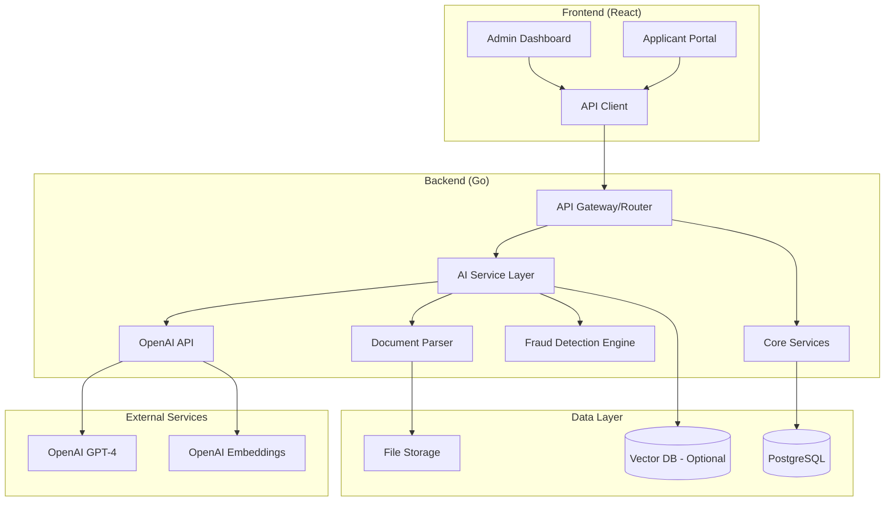
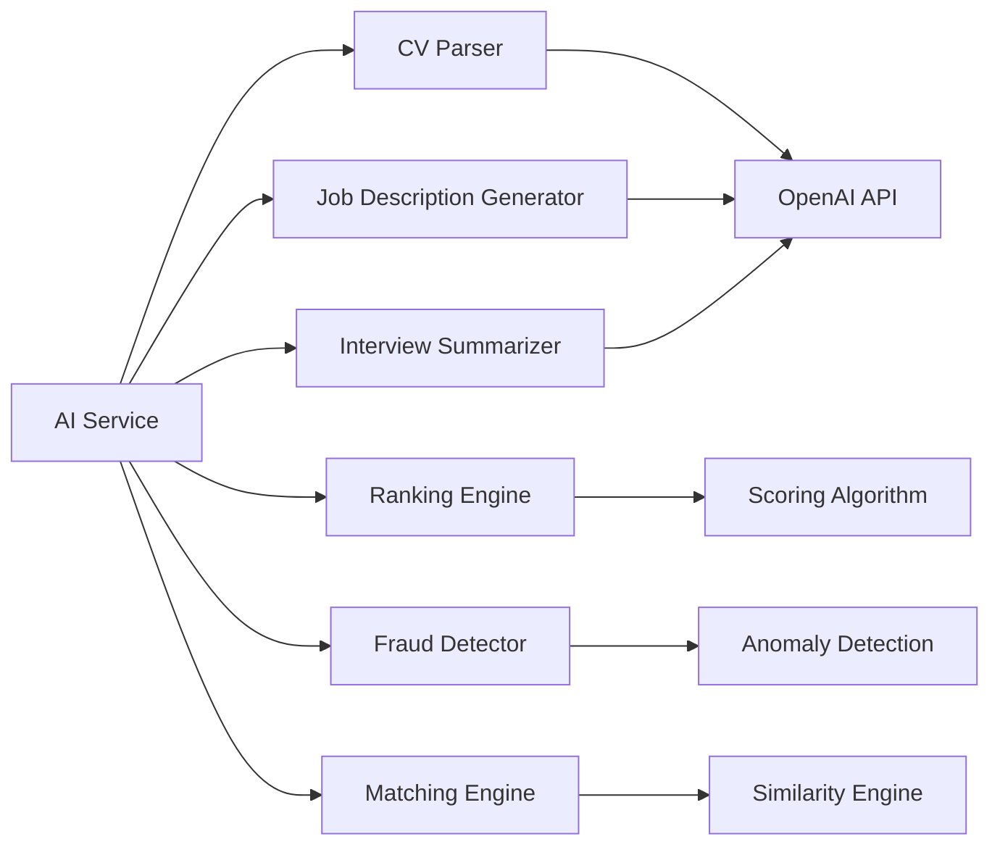
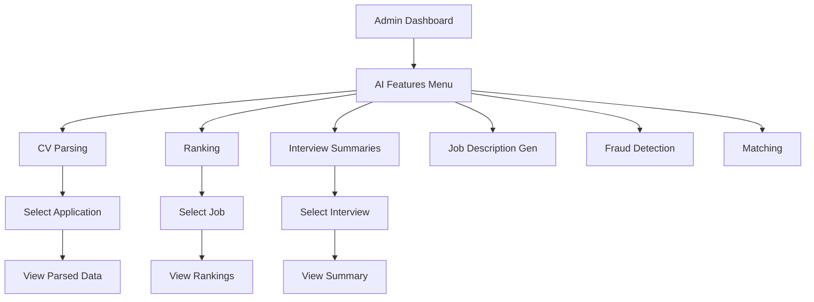

# AI Features Implementation Architecture

## Overview

This document outlines the technical architecture and implementation plan for AI-powered features in the Job Application Portal (JAP). The features include CV Parsing, AI Candidate Ranking, Interview Summaries, AI Job Description Generation, Fraud Detection, and Candidate Matching.

---

## Table of Contents

1. [System Architecture](#system-architecture)
2. [Database Schema Extensions](#database-schema-extensions)
3. [Feature Specifications](#feature-specifications)
4. [API Design](#api-design)
5. [Frontend Integration](#frontend-integration)
6. [External Service Integrations](#external-service-integrations)
7. [Implementation Roadmap](#implementation-roadmap)
8. [Security & Compliance](#security--compliance)

---

## System Architecture

### High-Level Architecture Diagram



### AI Service Layer Components



---

## Database Schema Extensions

### New Tables

#### `ai_parsed_data`
Stores parsed information from CVs and documents.

```sql
CREATE TABLE ai_parsed_data (
    id UUID PRIMARY KEY DEFAULT gen_random_uuid(),
    document_id UUID REFERENCES documents(id),
    application_id UUID REFERENCES applications(id),
    parsed_json JSONB,
    skills TEXT[],
    experience_years INTEGER,
    education_level TEXT,
    extracted_text TEXT,
    confidence_score DECIMAL(3,2),
    created_at TIMESTAMP DEFAULT NOW(),
    updated_at TIMESTAMP DEFAULT NOW()
);
```

#### `candidate_scores`
Stores AI-generated candidate scores and rankings.

```sql
CREATE TABLE candidate_scores (
    id UUID PRIMARY KEY DEFAULT gen_random_uuid(),
    application_id UUID REFERENCES applications(id),
    job_id UUID REFERENCES jobs(id),
    overall_score DECIMAL(5,2),
    skills_match_score DECIMAL(5,2),
    experience_score DECIMAL(5,2),
    education_score DECIMAL(5,2),
    fraud_risk_score DECIMAL(5,2),
    ranking_position INTEGER,
    explanation TEXT,
    created_at TIMESTAMP DEFAULT NOW(),
    updated_at TIMESTAMP DEFAULT NOW()
);
```

#### `interview_summaries`
Stores AI-generated interview summaries.

```sql
CREATE TABLE interview_summaries (
    id UUID PRIMARY KEY DEFAULT gen_random_uuid(),
    application_id UUID REFERENCES applications(id),
    interview_type TEXT, -- 'phone', 'video', 'in-person'
    transcript TEXT,
    summary TEXT,
    key_points JSONB,
    sentiment_score DECIMAL(3,2),
    created_at TIMESTAMP DEFAULT NOW()
);
```

#### `fraud_detection_logs`
Tracks fraud detection events and risk scores.

```sql
CREATE TABLE fraud_detection_logs (
    id UUID PRIMARY KEY DEFAULT gen_random_uuid(),
    application_id UUID REFERENCES applications(id),
    document_id UUID REFERENCES documents(id),
    risk_score DECIMAL(5,2),
    risk_factors JSONB,
    flagged BOOLEAN,
    reviewed BOOLEAN,
    reviewed_by TEXT,
    created_at TIMESTAMP DEFAULT NOW()
);
```

#### `job_descriptions_ai`
Stores AI-generated job descriptions.

```sql
CREATE TABLE job_descriptions_ai (
    id UUID PRIMARY KEY DEFAULT gen_random_uuid(),
    job_id UUID REFERENCES jobs(id),
    generated_description TEXT,
    prompt_used TEXT,
    tokens_used INTEGER,
    created_at TIMESTAMP DEFAULT NOW()
);
```

#### `candidate_matches`
Stores candidate-to-job matching results.

```sql
CREATE TABLE candidate_matches (
    id UUID PRIMARY KEY DEFAULT gen_random_uuid(),
    applicant_id UUID REFERENCES applicants(id),
    job_id UUID REFERENCES jobs(id),
    match_score DECIMAL(5,2),
    matching_skills TEXT[],
    missing_skills TEXT[],
    created_at TIMESTAMP DEFAULT NOW()
);
```

---

## Feature Specifications

### 1. CV Parsing

**Purpose**: Automatically extract structured data from uploaded CVs.

**Capabilities**:
- Extract personal information (name, email, phone)
- Parse work experience (companies, roles, durations)
- Extract skills and competencies
- Identify education history
- Calculate total experience years

**Implementation**:
```
Input: PDF/DOCX file
Process:
  1. Convert to text using OCR if needed
  2. Send to OpenAI GPT-4 with structured prompt
  3. Parse JSON response
  4. Store in ai_parsed_data table
Output: Structured JSON with extracted fields
```

**Prompt Template**:
```
Extract the following from this CV and return as JSON:
- full_name
- email
- phone
- skills (array)
- work_experience: [{company, role, start_date, end_date}]
- education: [{institution, degree, year}]
- total_experience_years (number)
```

### 2. AI Candidate Ranking

**Purpose**: Rank candidates based on job requirements and qualifications.

**Scoring Algorithm**:
```
Overall Score = (Skills Match × 0.4) + (Experience × 0.3) + (Education × 0.2) + (Fraud Risk × 0.1)

Skills Match:
- Required skills found / Total required skills
- Weight by skill importance

Experience:
- Years of relevant experience
- Role similarity to job

Education:
- Degree level match
- Field of study relevance
```

**Implementation**:
```go
type CandidateScore struct {
    ApplicationID uint
    JobID         uint
    OverallScore  float64
    SkillsScore   float64
    ExperienceScore float64
    EducationScore  float64
    FraudRiskScore  float64
    Explanation     string
}
```

### 3. Interview Summaries

**Purpose**: Generate concise summaries from interview transcripts.

**Features**:
- Key points extraction
- Sentiment analysis
- Red flags identification
- Follow-up questions suggestions

**Input Sources**:
- Manual transcript entry
- Audio recording (future)
- Video call integration (future)

### 4. AI Job Description Generation

**Purpose**: Generate professional job descriptions from basic inputs.

**Inputs**:
- Job title
- Department
- Required skills
- Experience level
- Company values (optional)

**Output**:
- Professional job description
- Responsibilities list
- Qualifications list
- Benefits section

### 5. Fraud Detection

**Purpose**: Identify potentially fraudulent applications.

**Detection Methods**:
- Document similarity (cross-application)
- IP address analysis
- Submission pattern anomalies
- Content analysis (inconsistent information)
- File manipulation detection

**Risk Factors**:
- Multiple applications from same IP
- Similar CVs with different names
- Suspicious file modifications
- Unusual submission timing

### 6. Candidate Matching

**Purpose**: Recommend jobs to candidates and candidates to jobs.

**Matching Algorithm**:
```
Match Score = (Skills Similarity × 0.4) + (Experience Fit × 0.3) + (Location × 0.1) + (Preferences × 0.2)
```

**Features**:
- Skill-based matching
- Experience level matching
- Location preferences
- Career progression patterns

---

## API Design

### CV Parsing Endpoints

```
POST /api/v1/ai/cv-parse
{
  "document_id": 123
}

Response:
{
  "parsed_data": {
    "full_name": "John Doe",
    "email": "john@example.com",
    "skills": ["Go", "React", "PostgreSQL"],
    "experience_years": 5,
    "education": [...]
  },
  "confidence_score": 0.92
}
```

### Candidate Ranking Endpoints

```
GET /api/v1/ai/candidate-ranking/:jobId
Response:
{
  "rankings": [
    {
      "application_id": 1,
      "applicant_name": "John Doe",
      "overall_score": 87.5,
      "skills_match": 90,
      "experience": 85,
      "ranking_position": 1
    }
  ]
}

POST /api/v1/ai/candidate-ranking/:jobId/regenerate
```

### Interview Summary Endpoints

```
POST /api/v1/ai/interview-summary
{
  "application_id": 123,
  "transcript": "Full interview transcript...",
  "interview_type": "video"
}

Response:
{
  "summary": "Candidate has 5 years experience...",
  "key_points": ["Strong technical skills", "Good cultural fit"],
  "sentiment_score": 0.75
}
```

### Job Description Generation Endpoints

```
POST /api/v1/ai/job-description
{
  "title": "Senior Software Engineer",
  "department": "Engineering",
  "required_skills": ["Go", "React", "PostgreSQL"],
  "experience_level": "senior"
}

Response:
{
  "description": "We are looking for a Senior Software Engineer...",
  "responsibilities": [...],
  "qualifications": [...]
}
```

### Fraud Detection Endpoints

```
GET /api/v1/ai/fraud-detection/:applicationId
Response:
{
  "risk_score": 25,
  "risk_factors": ["Similar CV detected", "Unusual IP pattern"],
  "flagged": false
}

POST /api/v1/ai/fraud-detection/scan-all
```

### Candidate Matching Endpoints

```
GET /api/v1/ai/candidate-matches/:jobId
Response:
{
  "matches": [
    {
      "applicant_id": 1,
      "match_score": 85,
      "matching_skills": ["Go", "React"],
      "missing_skills": ["Python"]
    }
  ]
}

GET /api/v1/ai/candidate-matches/recommendations/:applicantId
```

---

## Frontend Integration

### New Components

#### `AICandidateRanking.tsx`
- Displays ranked candidates with scores
- Visual score breakdown
- Filter by score threshold

#### `CVParserView.tsx`
- Shows parsed CV data
- Confidence indicators
- Manual correction interface

#### `InterviewSummary.tsx`
- Transcript input area
- Generated summary display
- Key points highlighting

#### `JobDescriptionGenerator.tsx`
- Form for job details
- Generated description preview
- Regenerate option

#### `FraudDetectionDashboard.tsx`
- Risk score visualization
- Flagged applications list
- Review interface

#### `CandidateMatcher.tsx`
- Match score display
- Skill matching visualization
- Recommendation list

### UI Flow



---

## External Service Integrations

### OpenAI API

**Required Models**:
- `gpt-4-turbo` - For complex parsing and generation
- `gpt-3.5-turbo` - For simpler tasks (cost optimization)
- `text-embedding-3-small` - For similarity matching

**Configuration**:
```go
type OpenAIConfig struct {
    APIKey     string
    BaseURL    string
    MaxTokens  int
    Temperature float64
}
```

**Rate Limiting**:
- Implement request queuing
- Cache responses where appropriate
- Use streaming for long responses

### Document Processing

**Libraries**:
- `unidoc/unioffice` - DOCX processing
- `pdfcpu` - PDF text extraction
- `tesseract` - OCR for scanned documents

### Vector Database (Optional)

For advanced similarity matching:
- `weaviate` - Open-source vector DB
- `pinecone` - Managed vector DB
- `supabase` - Postgres with vector extension

---

## Implementation Roadmap

### Phase 1: Foundation (Weeks 1-2)

- [ ] Set up AI service layer structure
- [ ] Add database migrations for new tables
- [ ] Implement OpenAI client wrapper
- [ ] Create basic CV parsing endpoint
- [ ] Add configuration for AI services

### Phase 2: Core Features (Weeks 3-4)

- [ ] Implement CV parsing with OpenAI
- [ ] Build candidate ranking algorithm
- [ ] Create fraud detection engine
- [ ] Add API endpoints
- [ ] Basic frontend components

### Phase 3: Advanced Features (Weeks 5-6)

- [ ] Interview summary generation
- [ ] Job description generation
- [ ] Candidate matching algorithm
- [ ] Enhanced fraud detection
- [ ] UI polish and testing

### Phase 4: Optimization (Weeks 7-8)

- [ ] Caching layer for AI responses
- [ ] Performance optimization
- [ ] Error handling and retries
- [ ] Documentation and examples
- [ ] Production deployment

---

## Security & Compliance

### Data Privacy

- **PII Handling**: Mask sensitive data in logs
- **Data Retention**: Configurable retention policies
- **Encryption**: Encrypt stored AI data at rest
- **Access Control**: Role-based access to AI features

### API Security

- **Rate Limiting**: Prevent abuse of AI endpoints
- **Input Validation**: Sanitize all inputs
- **Output Filtering**: Remove sensitive data from responses
- **Audit Logging**: Log all AI operations

### Compliance Considerations

- **GDPR**: Right to explanation for AI decisions
- **Data Protection Act (Uganda)**: Local compliance
- **Consent**: Clear disclosure of AI usage
- **Bias Mitigation**: Regular auditing of algorithms

---

## Cost Considerations

### OpenAI API Costs (Estimates)

| Feature | Model | Tokens/Request | Requests/Month | Est. Cost |
|---------|-------|----------------|----------------|-----------|
| CV Parsing | GPT-4 | 2,000 | 500 | $30 |
| Ranking | GPT-3.5 | 500 | 2,000 | $10 |
| Interview Summary | GPT-4 | 3,000 | 200 | $12 |
| Job Description | GPT-3.5 | 1,000 | 100 | $2 |
| Fraud Detection | GPT-3.5 | 1,500 | 1,000 | $7 |

**Total Monthly Estimate**: ~$61

### Optimization Strategies

1. **Caching**: Cache parsed CVs for 30 days
2. **Batch Processing**: Process multiple documents together
3. **Model Selection**: Use GPT-3.5 for simple tasks
4. **Prompt Optimization**: Minimize token usage

---

## Monitoring & Observability

### Metrics to Track

- API response times
- Token usage per feature
- Error rates
- Cache hit rates
- User engagement

### Logging

```go
type AILogEntry struct {
    RequestID   string
    Feature     string
    TokensUsed  int
    Duration    time.Duration
    Success     bool
    Error       string
}
```

---

## Conclusion

This architecture provides a scalable, secure foundation for AI-powered features in the Job Application Portal. The modular design allows for incremental implementation while maintaining flexibility for future enhancements.