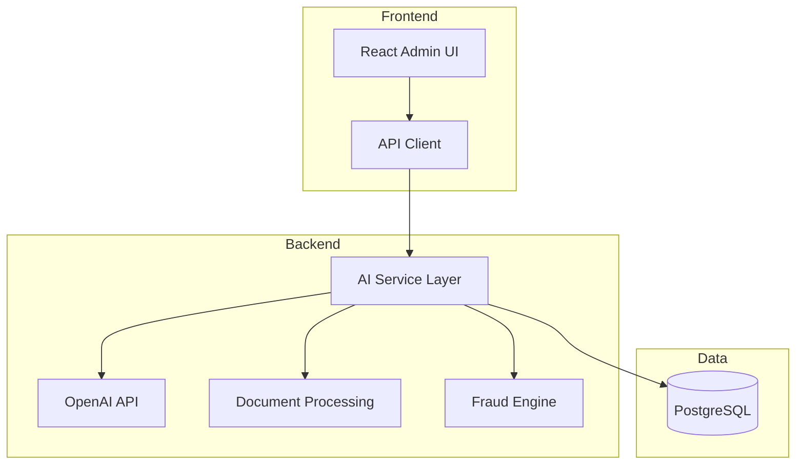

# AI Features Implementation - Executive Summary

## Overview

This document provides a high-level summary of the AI features implementation plan for the Job Application Portal (JAP).

---

## Features Summary

| Feature | Description | Complexity | Priority |
|---------|-------------|------------|----------|
| CV Parsing | Extract structured data from uploaded CVs | Medium | High |
| AI Candidate Ranking | Score and rank candidates based on job fit | Medium | High |
| Interview Summaries | Generate summaries from interview transcripts | Low | Medium |
| AI Job Description Generation | Create professional job descriptions | Low | Medium |
| Fraud Detection | Identify potentially fraudulent applications | High | High |
| Candidate Matching | Recommend jobs to candidates and vice versa | Medium | Medium |

---

## Architecture Overview

---

## Implementation Phases

### Phase 1: Foundation (Weeks 1-2)
- Set up AI service layer
- Add database migrations
- Implement OpenAI client
- Create basic CV parsing

### Phase 2: Core Features (Weeks 3-4)
- CV parsing with OpenAI
- Candidate ranking algorithm
- Fraud detection engine
- API endpoints
- Basic frontend

### Phase 3: Advanced Features (Weeks 5-6)
- Interview summaries
- Job description generation
- Candidate matching
- UI polish

### Phase 4: Optimization (Weeks 7-8)
- Caching
- Performance optimization
- Documentation
- Production deployment

---

## Key Technical Decisions

1. **AI Provider**: OpenAI GPT-4 for complex tasks, GPT-3.5 for cost optimization
2. **Database**: PostgreSQL with JSONB for flexible AI data storage
3. **Caching**: In-memory caching for parsed CVs (30-day TTL)
4. **Rate Limiting**: Per-user limits to prevent abuse
5. **Error Handling**: Graceful degradation when AI services are unavailable

---

## Cost Estimate

| Feature | Monthly Cost (Est.) |
|---------|---------------------|
| CV Parsing | $30 |
| Ranking | $10 |
| Interview Summary | $12 |
| Job Description | $2 |
| Fraud Detection | $7 |
| **Total** | **~$61/month** |

---

## Security & Compliance

- PII data masked in logs
- Configurable data retention
- Role-based access control
- Audit logging for all AI operations
- GDPR/Uganda Data Protection Act compliance

---

## Files Created

1. [`AI_FEATURES_ARCHITECTURE.md`](AI_FEATURES_ARCHITECTURE.md) - Detailed technical architecture
2. [`AI_IMPLEMENTATION_PLAN.md`](AI_IMPLEMENTATION_PLAN.md) - Implementation details and code structures
3. [`AI_FEATURES_SUMMARY.md`](AI_FEATURES_SUMMARY.md) - This executive summary

---

## Next Steps

1. Review the architecture and implementation plan
2. Set up OpenAI API key and billing
3. Begin Phase 1 implementation
4. Test with sample CVs and applications